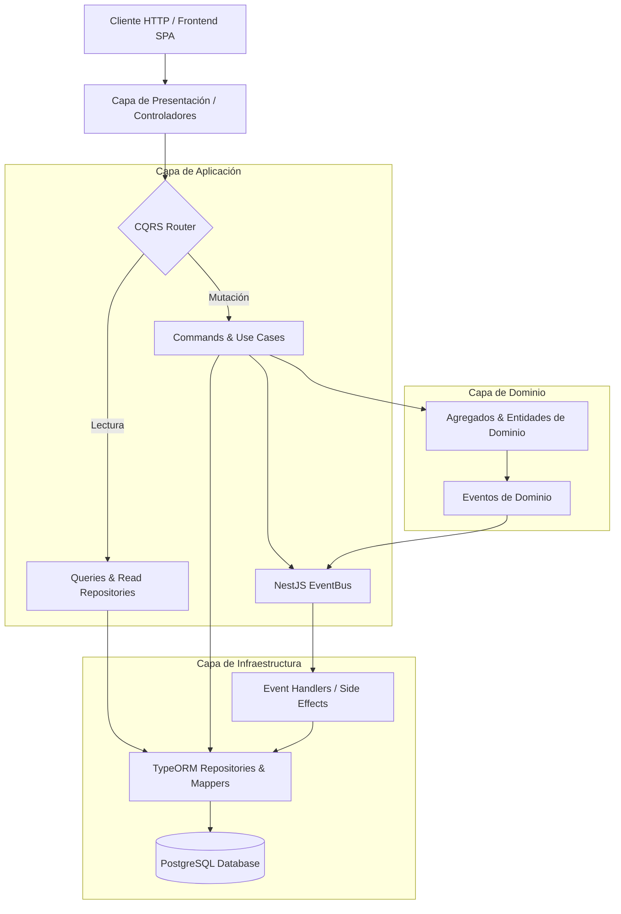

# Documentación Técnica del Backend — Ministore ERP

Bienvenido a la documentación arquitectónica, técnica y de API del backend de **Ministore ERP**. Este sistema está construido sobre **NestJS**, siguiendo estrictamente principios de **Clean Architecture**, **Domain-Driven Design (DDD)**, **CQRS** y **Event-Driven Architecture**.

---

## 🧭 Mapa de Navegación por Módulos

Cada módulo cuenta con su carpeta dedicada con especificaciones, diagramas ERD relacionales, diagramas de secuencia de flujo, casos de uso prácticos y colección de Postman:

| Módulo | Descripción | Diagrama ERD | Diagrama de Flujo | Casos de Uso | Postman Collection |
| :--- | :--- | :---: | :---: | :---: | :---: |
| **[IAM (Identidad y Seguridad)](./iam/README.md)** | Autenticación JWT RS256, Usuarios, Roles, Permisos y Perfil con Avatar. | [Ver ERD](./iam/erd-diagram.md) | [Ver Flujo](./iam/flow-diagram.md) | [Ver Casos](./iam/use-cases.md) | [Postman](./iam/iam.postman_collection.json) |
| **[Company (Empresa)](./company/README.md)** | Identidad corporativa, datos fiscales, moneda base, SMTP y logotipos. | [Ver ERD](./company/erd-diagram.md) | [Ver Flujo](./company/flow-diagram.md) | [Ver Casos](./company/use-cases.md) | [Postman](./company/company.postman_collection.json) |
| **[Catalog (Catálogo)](./catalog/README.md)** | Categorías, Unidades de medida, Productos (Simple/Compuesto) y Recetas (BOM). | [Ver ERD](./catalog/erd-diagram.md) | [Ver Flujo](./catalog/flow-diagram.md) | [Ver Casos](./catalog/use-cases.md) | [Postman](./catalog/catalog.postman_collection.json) |
| **[Inventory (Inventario)](./inventory/README.md)** | Almacenes, Existencias por bodega, Motivos y Transacciones Kardex (Lotes/Venc). | [Ver ERD](./inventory/erd-diagram.md) | [Ver Flujo](./inventory/flow-diagram.md) | [Ver Casos](./inventory/use-cases.md) | [Postman](./inventory/inventory.postman_collection.json) |
| **[Purchases (Compras)](./purchases/README.md)** | Órdenes de materias primas, Multimoneda, Conversión cambiaría y Eventos de stock. | [Ver ERD](./purchases/erd-diagram.md) | [Ver Flujo](./purchases/flow-diagram.md) | [Ver Casos](./purchases/use-cases.md) | [Postman](./purchases/purchases.postman_collection.json) |
| **[Sales (Ventas)](./sales/README.md)** | Cotizaciones, Ventas a crédito, Abonos/Pagos, Comprobantes y Reportes PDF/Excel. | [Ver ERD](./sales/erd-diagram.md) | [Ver Flujo](./sales/flow-diagram.md) | [Ver Casos](./sales/use-cases.md) | [Postman](./sales/sales.postman_collection.json) |
| **[Audit (Auditoría)](./audit/README.md)** | Trazabilidad forense, Snapshots diferenciales (diff), Métricas y Sanitización. | [Ver ERD](./audit/erd-diagram.md) | [Ver Flujo](./audit/flow-diagram.md) | [Ver Casos](./audit/use-cases.md) | [Postman](./audit/audit.postman_collection.json) |
| **[Storage (Almacenamiento)](./storage/README.md)** | Almacenamiento en nube Neon S3 por carpetas, Presigned URLs y visualización segura. | N/A (S3 Cloud) | [Ver Flujo](./storage/flow-diagram.md) | [Ver Casos](./storage/use-cases.md) | [Postman](./storage/storage.postman_collection.json) |

---

## 🏛️ Principios de Arquitectura del Backend

### 1. Zero Layer Contamination (Mappers de 3 Niveles)
- **Capa 1 (ORM Mapper)**: Mapea bidireccionalmente entre entidades de base de datos (`*.orm-entity.ts`) y modelos puros de TypeScript (`*.entity.ts`).
- **Capa 2 (Command Mapper)**: Mapea DTOs de entrada y Commands en Agregados de Dominio ejecutando validación de invariantes.
- **Capa 3 (Response Mapper)**: Transforma entidades de dominio en DTOs de salida para la API HTTP, asegurando que campos sensibles (como contraseñas o tokens) jamás lleguen al cliente.

### 2. Interface Segregation Principle (ISP) en Repositorios
Los contratos de acceso a datos separan explícitamente lectura y escritura:
- `I<Entity>ReadRepository`: Exclusivo para Queries (`findAll`, `findById`).
- `I<Entity>WriteRepository`: Exclusivo para Commands (`save`, `delete`).

### 3. Unidad de Trabajo Transaccional
Operaciones que involucran cabeceras y colecciones hijas (ej: Compras con renglones de materias primas o Ventas con ítems y pagos) se ejecutan dentro de transacciones atómicas mediante `dataSource.transaction(...)`.

---

## 🚀 Uso de las Colecciones de Postman

1. Abre **Postman** y haz clic en **Import**.
2. Selecciona cualquiera de las colecciones situadas en `backend/docs/<modulo>/<modulo>.postman_collection.json`.
3. La variable `{{baseUrl}}` viene configurada por defecto a `http://localhost:3000`.
4. Ejecuta la petición **Auth > Login**; el script de pruebas configurará automáticamente la variable `{{token}}` para autenticar todas las peticiones protegidas subsecuentes.
