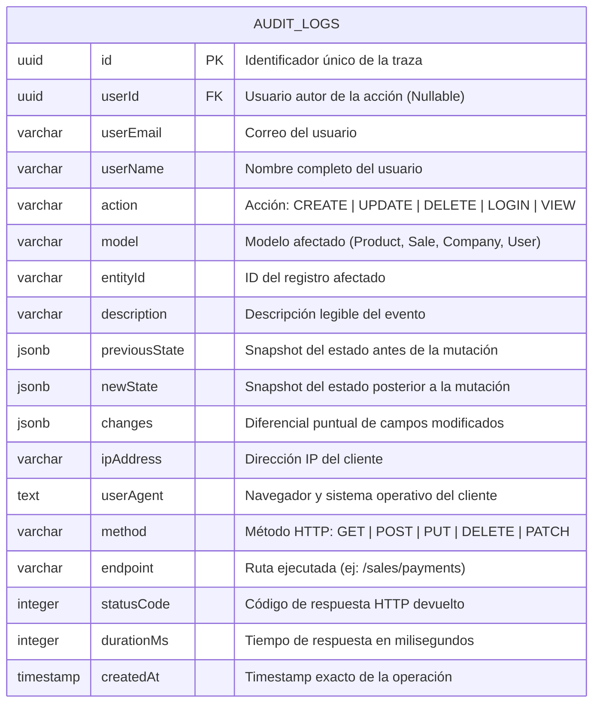

# Diagrama de Base de Datos (ERD) — Módulo Audit

Estructura de persistencia en PostgreSQL con soporte para estructuras JSONB indexadas de trazas forenses.

---

## 📌 Índices y Optimización para Alto Volumen

- **Índice B-Tree en `action`**: Acelera consultas de filtrado por tipos de evento (`UPDATE`, `LOGIN`).
- **Índice B-Tree en `model`**: Permite auditar el historial completo de una entidad específica (ej: todas las modificaciones al modelo `Sale`).
- **Índice B-Tree en `userId`**: Facilita reportes de actividad por operador o cajero.
- **Índice en `createdAt`**: Optimiza ordenamiento descendente y ventanas de tiempo en dashboards.
- **Columnas JSONB (`previousState`, `newState`, `changes`)**: Almacenan estructuras semiestructuradas sin esquema rígido, permitiendo comparar cualquier agregado de la aplicación.
