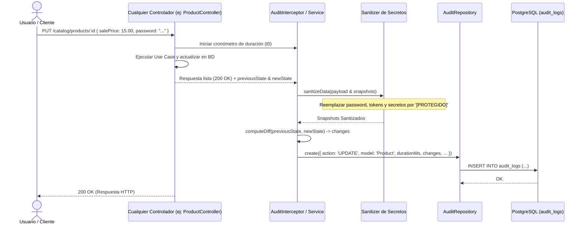
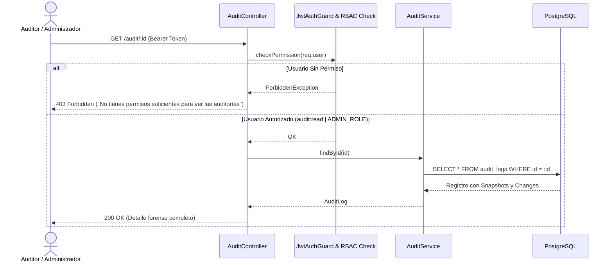

# Diagramas de Flujo — Módulo Audit

Diagramas de secuencia del proceso de captura de eventos, sanitización y consulta forense.

---

## 1. Flujo de Captura y Sanitización de Trazas (Interceptor / Servicio)

---

## 2. Flujo de Consulta Forense y Verificación de Permisos (`GET /audit/:id`)

