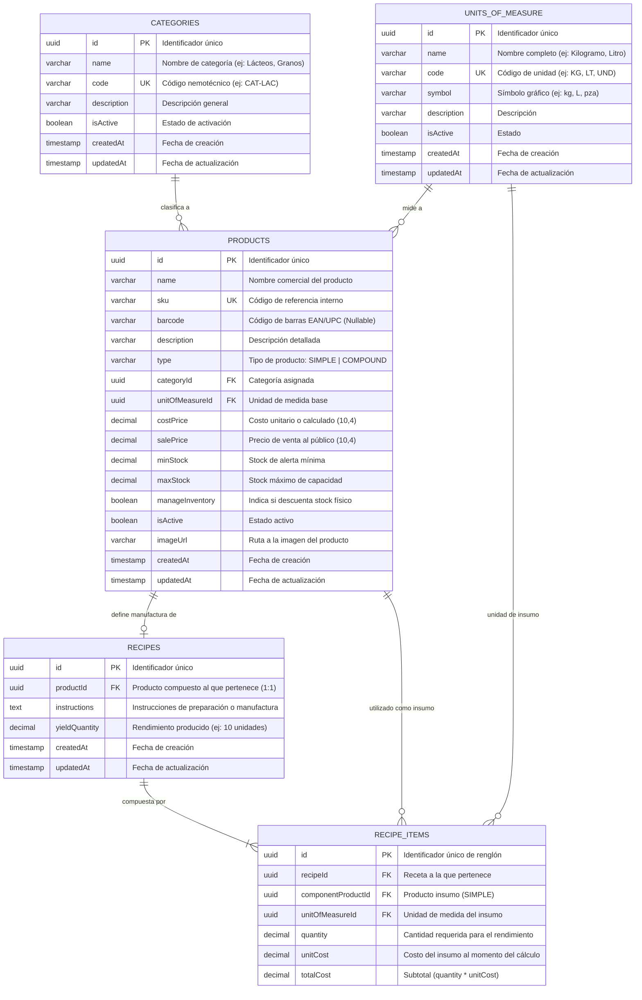

# Diagrama de Base de Datos (ERD) — Módulo Catalog

A continuación se presenta el modelo relacional que soporta el catálogo de productos simples y recetas estructuradas (BOM) en PostgreSQL.

---

## 🔗 Relaciones y Cardinalidades Clave

1. **`categories` ↔ `products` (1:N)**: Un producto pertenece a una categoría, permitiendo agrupaciones por familias de productos.
2. **`units_of_measure` ↔ `products` (1:N)**: Cada producto cuenta con una unidad de medida estándar obligatoria para transacciones y compras.
3. **`products` ↔ `recipes` (1:1)**: Un producto compuesto (`type = 'COMPOUND'`) tiene exactamente una receta activa que describe su fórmula de fabricación.
4. **`recipes` ↔ `recipe_items` (1:N)**: La receta contiene múltiples renglones de materias primas que enlazan a productos simples (`componentProductId`), totalizando los costos de ensamble.
