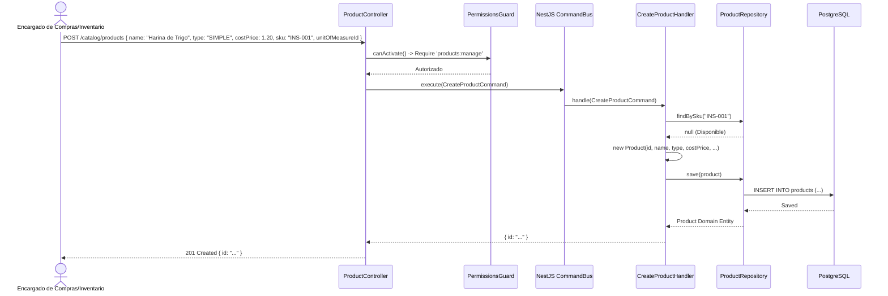

# Diagramas de Flujo — Módulo Catalog

Diagramas de secuencia de las operaciones principales del catálogo: creación de insumos, cálculo automático de costos en recetas y actualización de precios.

---

## 1. Flujo de Creación de Producto Simple (Materia Prima)



---

## 2. Flujo de Creación de Receta y Recálculo de Costos del Producto Compuesto

```mermaid
sequenceDiagram
    actor Chef as Jefe de Producción
    participant Controller as RecipesController
    participant CommandBus as NestJS CommandBus
    participant Handler as CreateRecipeHandler
    participant ProductRepo as ProductRepository
    participant RecipeRepo as RecipeRepository
    participant DB as PostgreSQL

    Chef->>Controller: POST /catalog/recipes { productId: "PROD-PAN", yieldQuantity: 10, items: [ { componentProductId: "INS-001", quantity: 2.5, unitCost: 1.20 }, { componentProductId: "INS-002", quantity: 0.1, unitCost: 5.00 } ] }
    Controller->>CommandBus: execute(CreateRecipeCommand)
    CommandBus->>Handler: handle(CreateRecipeCommand)
    
    Handler->>ProductRepo: findById("PROD-PAN")
    ProductRepo-->>Handler: Producto (Verifica type == 'COMPOUND')
    
    Handler->>Handler: Calcular Subtotales por Item:
    note over Handler: Item 1: 2.5 * 1.20 = $3.00<br/>Item 2: 0.1 * 5.00 = $0.50<br/>Costo Total Receta = $3.50<br/>Costo Unitario = $3.50 / 10 = $0.35 por unidad
    
    Handler->>RecipeRepo: save(recipe + recipe_items)
    RecipeRepo->>DB: INSERT INTO recipes ...; INSERT INTO recipe_items ...
    DB-->>RecipeRepo: Guardado
    
    Handler->>ProductRepo: updateCostPrice("PROD-PAN", newCost: 0.35)
    ProductRepo->>DB: UPDATE products SET "costPrice" = 0.35 WHERE id = "PROD-PAN"
    DB-->>ProductRepo: OK
    
    Handler-->>Controller: Recipe Creada con Costos Actualizados
    Controller-->>Chef: 201 Created (Receta vinculada y costo sincronizado)
```
