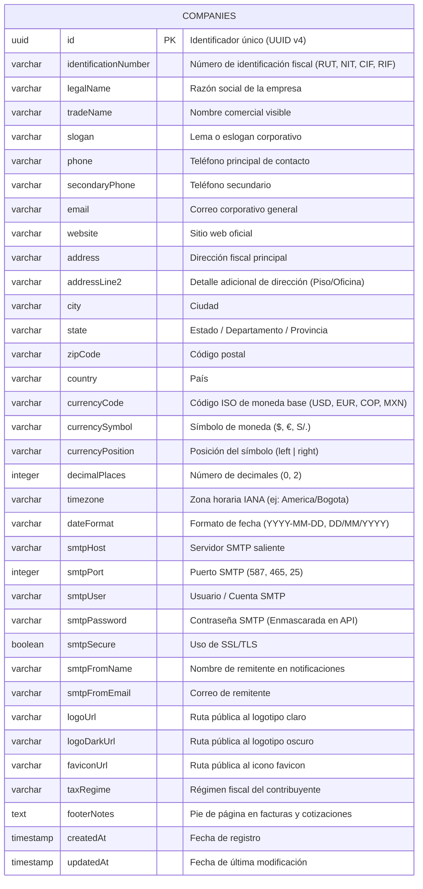

# Diagrama de Base de Datos (ERD) — Módulo Company

A continuación se detalla la estructura relacional de la tabla `companies` gestionada por TypeORM en PostgreSQL.

---

## 📌 Campos Críticos y Reglas de Integridad

- **Moneda Base (`currencyCode`, `currencySymbol`, `currencyPosition`, `decimalPlaces`)**: Gobierna el formateo financiero en todo el ERP (compras, ventas, cotizaciones, listas de precios y reportes contables).
- **Parámetros Regionales (`timezone`, `dateFormat`)**: Controlan el timestamping en auditorías y la emisión de documentos legales.
- **Configuración de Correo (`smtp*`)**: Utilizado por el subsistema de envíos de cotizaciones a clientes, reseteo de contraseñas y alertas de stock bajo.
