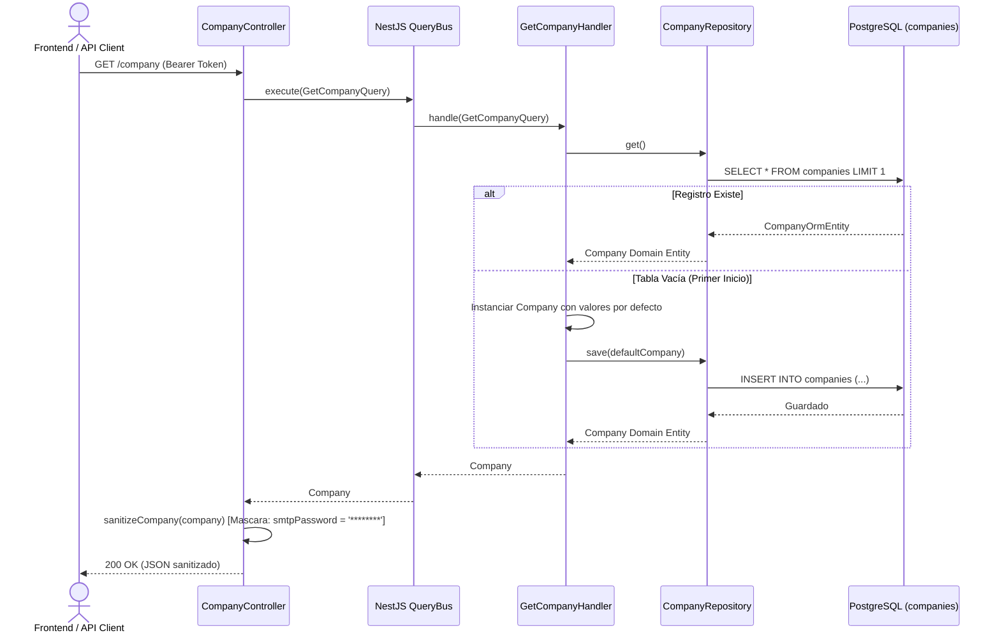
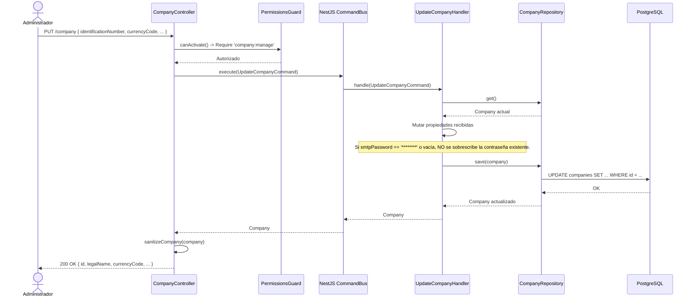
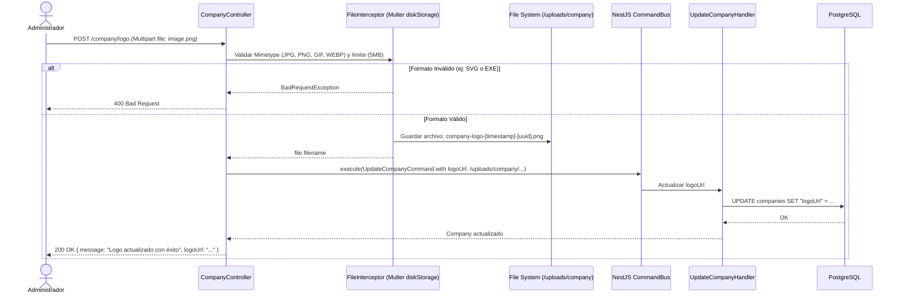

# Diagramas de Flujo — Módulo Company

A continuación se exponen las secuencias de interacción CQRS y de infraestructura del módulo de configuración empresarial.

---

## 1. Flujo de Consulta de Empresa (`GET /company`)

---

## 2. Flujo de Actualización de Configuración (`PUT /company`)

---

## 3. Flujo de Subida de Logotipo (`POST /company/logo`)

