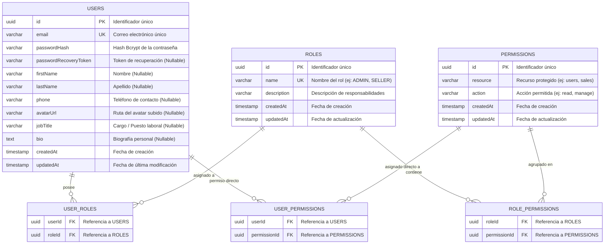

# Diagrama de Base de Datos (ERD) - Módulo IAM

A continuación se muestra el modelo relacional del módulo IAM (Identity and Access Management), que soporta autenticación JWT asimétrica (RS256), perfiles de usuario enriquecidos y control de acceso basado en roles (RBAC) con permisos granulares.

---

## 🔑 Diccionario Relacional y Cardinalidad

1. **`users` ↔ `roles` (Muchos a Muchos - N:M)**:
   - Tabla pivote: `user_roles`.
   - Permite que un usuario tenga múltiples roles funcionales simultáneos (ej: Operador y Auditor).
2. **`roles` ↔ `permissions` (Muchos a Muchos - N:M)**:
   - Tabla pivote: `role_permissions`.
   - Agrupa permisos estructurados bajo la convención `<resource>:<action>` (ej: `sales:manage`, `purchases:read`).
3. **`users` ↔ `permissions` (Muchos a Muchos - N:M)**:
   - Tabla pivote: `user_permissions`.
   - Permite excepciones o privilegios temporales asignados directamente al usuario sin necesidad de crear un nuevo rol.
