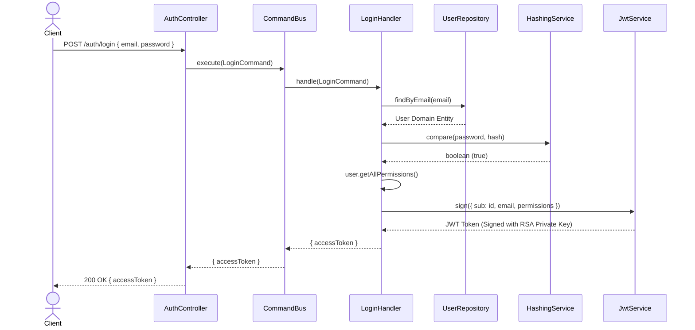
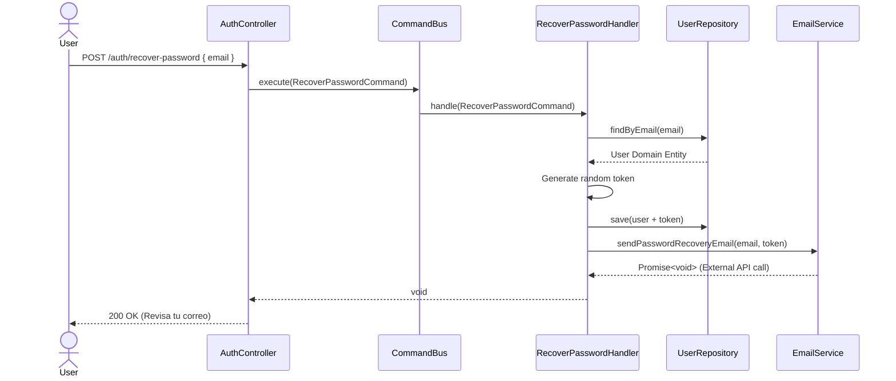
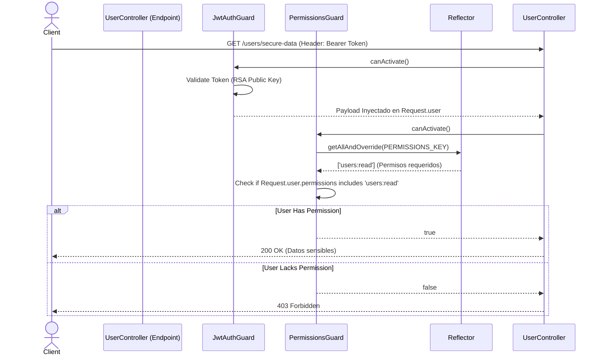

# Diagramas de Flujo (Secuencia)

A continuación se exponen los flujos principales del módulo IAM utilizando diagramas de secuencia para entender la interacción entre los puertos, los casos de uso (Commands) y la infraestructura.

## 1. Flujo de Login (Autenticación)

## 2. Flujo de Recuperación de Contraseña

## 3. Flujo de Autorización en Endpoints Protegidos (RBAC)

