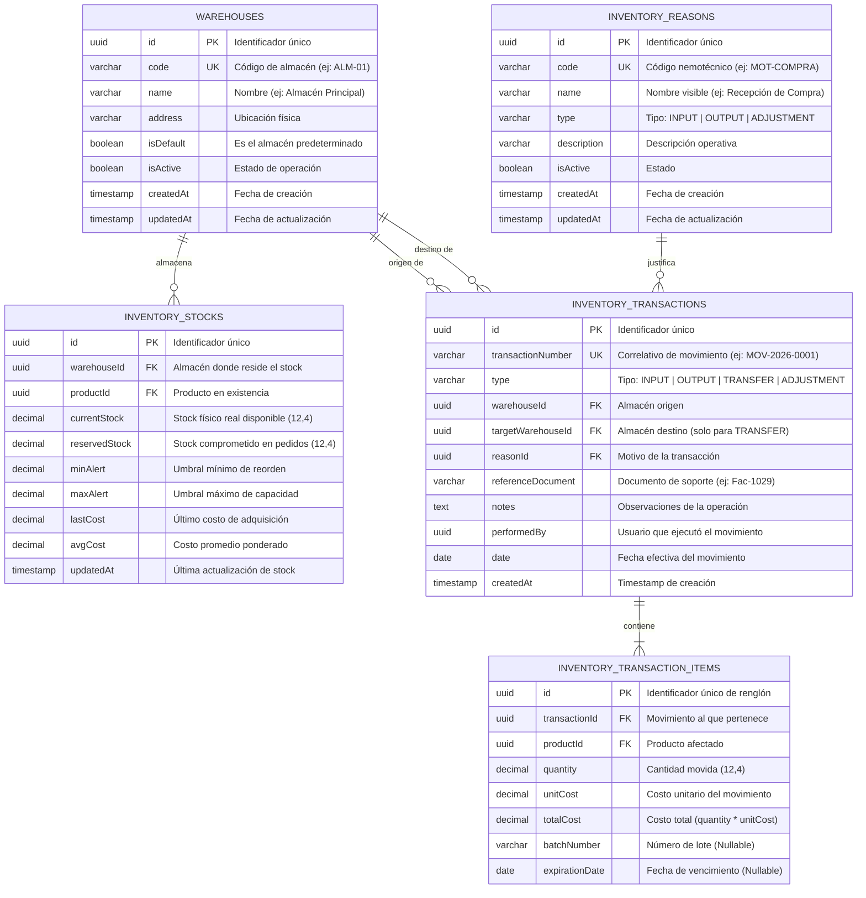

# Diagrama de Base de Datos (ERD) — Módulo Inventory

Modelo entidad-relación del subsistema de inventarios multialmacén, control de stock por depósito y transacciones kardex.

---

## 🔗 Relaciones y Reglas de Integridad

1. **`inventory_stocks` (Clave Única Compuesta `warehouseId` + `productId`)**: Cada par Almacén-Producto tiene exactamente un registro de stock que consolida el saldo actual y los costos promedio.
2. **`inventory_transactions` ↔ `inventory_transaction_items` (1:N)**: Estructura Cabecera-Detalle atómica. El recálculo de stock de todos los renglones se ejecuta dentro de una transacción de base de datos (`Unit of Work`).
3. **Transferencias (`TRANSFER`)**: La transacción vincula `warehouseId` (origen) y `targetWarehouseId` (destino).
