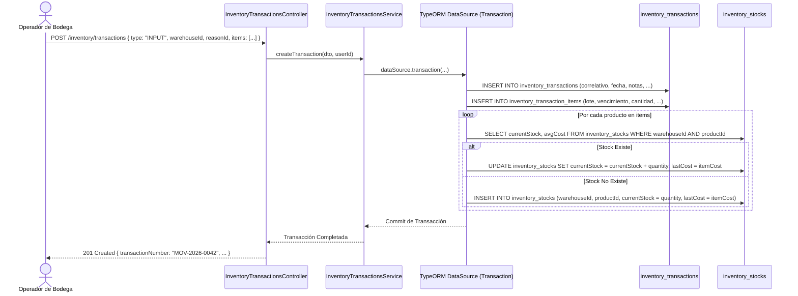
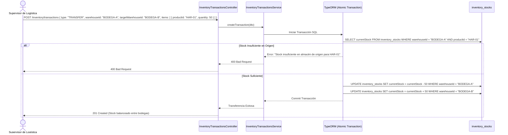

# Diagramas de Flujo — Módulo Inventory

Diagramas de secuencia que describen la ejecución atómica de movimientos de inventario y transferencias entre depósitos.

---

## 1. Flujo de Transacción de Entrada (`INPUT`) y Actualización de Stock

---

## 2. Flujo de Transferencia Entre Almacenes (`TRANSFER`)

