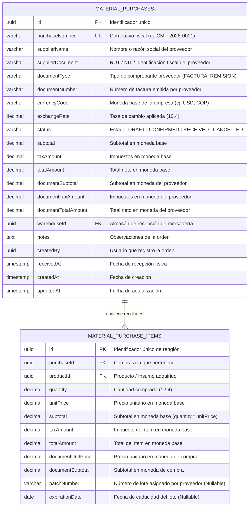

# Diagrama de Base de Datos (ERD) — Módulo Purchases

Modelo relacional de cabecera y detalle de compras de materias primas con soporte de conversión multimoneda y almacén de destino.

---

## 🔗 Relaciones y Reglas de Integridad

1. **`material_purchases` ↔ `material_purchase_items` (1:N Cascada)**:
   - Los ítems están subordinados al agregado raíz. Si la orden está en `DRAFT`, el guardado sincroniza atómicamente la lista de renglones.
2. **`warehouseId` (Almacén Receptor)**:
   - Almacena el destino final de los insumos. Cuando el estatus pasa a `RECEIVED`, el `MaterialPurchaseCompletedListener` utiliza este ID para alimentar el Kardex físico del almacén correspondiente.
3. **Dual Currency (`documentTotalAmount` vs `totalAmount`)**:
   - Garantiza consistencia en auditorías contables frente a fluctuaciones cambiarias.
