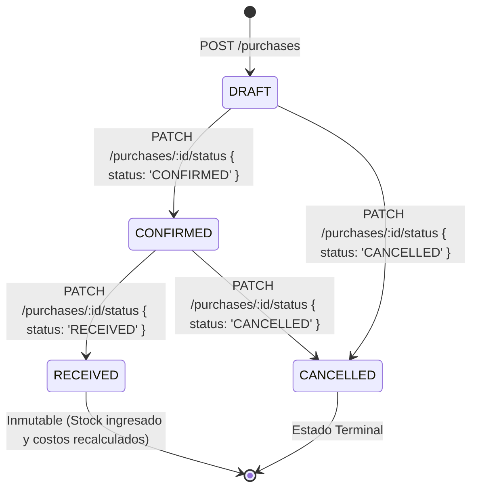
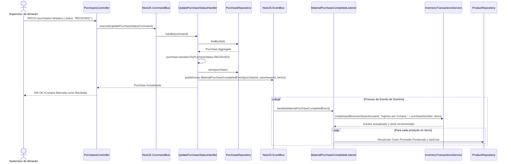

# Diagramas de Flujo — Módulo Purchases

Diagramas de secuencia del ciclo de vida de una compra y la propagación desacoplada mediante eventos de dominio (`CQRS EventBus`).

---

## 1. Máquina de Estados del Documento de Compra

---

## 2. Flujo de Recepción y Desacoplamiento Event-Driven (`RECEIVED`)

