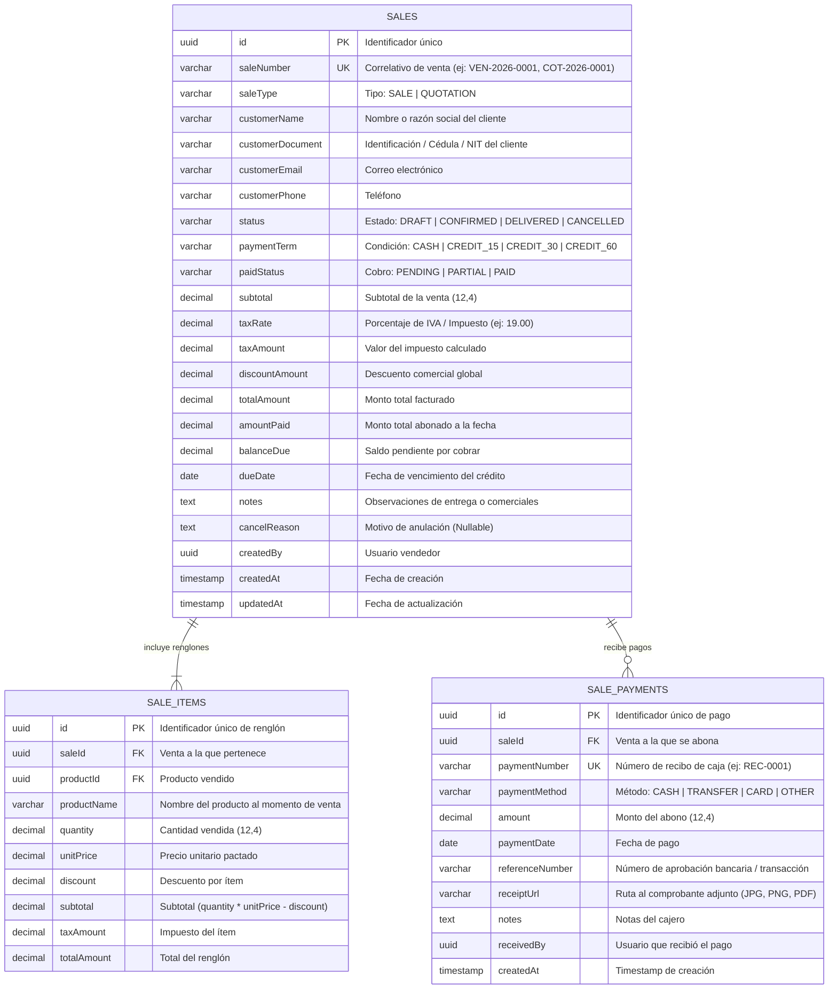

# Diagrama de Base de Datos (ERD) — Módulo Sales

Modelo entidad-relación del subsistema de ventas, cotizaciones, ítems facturados y comprobantes de pago.

---

## 🔗 Relaciones y Reglas de Integridad Financiera

1. **`sales` ↔ `sale_items` (1:N Cascada)**: Los renglones totalizan la base imponible y el impuesto.
2. **`sales` ↔ `sale_payments` (1:N)**: Una venta puede recibir múltiples pagos a lo largo del tiempo.
3. **Invariante Financiera de Cartera**:
   $$\text{balanceDue} = \text{totalAmount} - \sum(\text{sale\_payments.amount})$$
   $$\text{paidStatus} = \begin{cases} \text{PAID} & \text{si } \text{balanceDue} \le 0 \\ \text{PARTIAL} & \text{si } 0 < \text{amountPaid} < \text{totalAmount} \\ \text{PENDING} & \text{si } \text{amountPaid} = 0 \end{cases}$$
