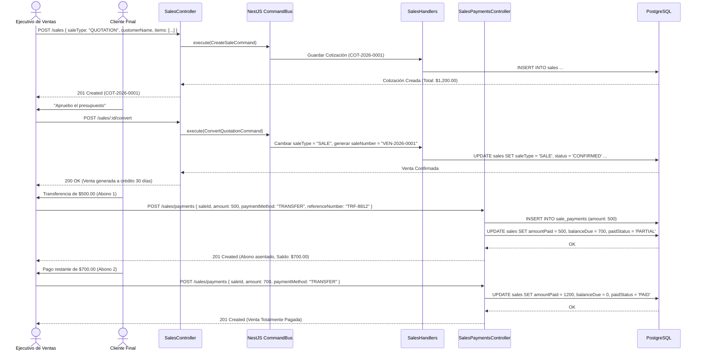

# Diagramas de Flujo — Módulo Sales

Diagramas de secuencia del ciclo comercial: desde la cotización hasta el cobro y generación de reportes.

---

## 1. Ciclo de Vida Comercial: Cotización ➔ Venta ➔ Cobro



---

## 2. Flujo de Generación de Comprobante PDF (`GET /sales/:id/pdf`)

```mermaid
sequenceDiagram
    actor Client as Cliente / Vendedor
    participant Controller as SalesReportsController
    participant Service as SalesReportsService
    participant CompanyRepo as CompanyRepository
    participant SaleRepo as SaleRepository
    participant PdfMake as pdfmake Engine

    Client->>Controller: GET /sales/:id/pdf
    Controller->>Service: generateSalePdf(id)
    Service->>SaleRepo: findById(id) with items & payments
    SaleRepo-->>Service: Sale Data
    Service->>CompanyRepo: get()
    CompanyRepo-->>Service: Company (Logo, Moneda, Nombre Legal, NIT)
    
    Service->>PdfMake: Construir Document Definition (Header con logo, tabla de items, subtotales, pie fiscal)
    PdfMake-->>Service: Buffer de documento PDF compilado
    
    Service-->>Controller: Buffer binario application/pdf
    Controller-->>Client: 200 OK (Content-Type: application/pdf; inline/attachment)
```
