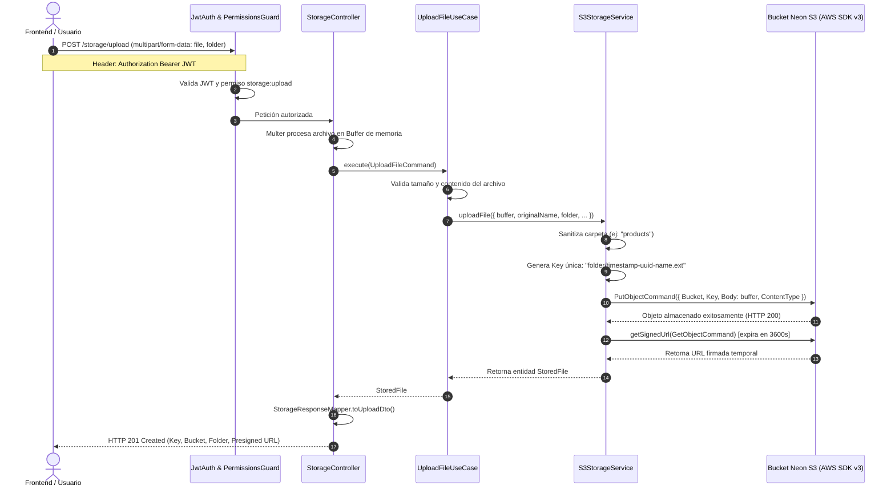
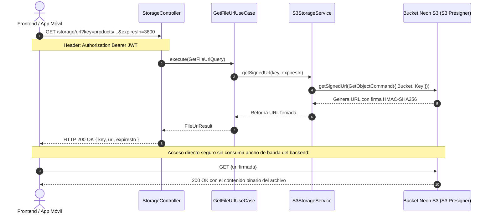
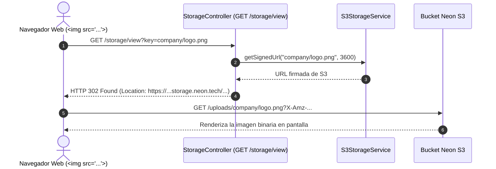

# Diagramas de Flujo — Módulo de Almacenamiento (Storage)

Este documento detalla la interacción entre el cliente (Frontend/Consumidor API), el controlador NestJS, los casos de uso CQRS, el servicio adaptador S3 y el bucket en la nube de Neon.

---

## 1. Flujo de Subida Multipart hacia Neon S3 (`POST /storage/upload`)

En este flujo el archivo se recibe en la memoria RAM del servidor sin tocar disco local (`memoryStorage()`) y se transfiere de inmediato a Neon S3 mediante un comando `PutObjectCommand`. Seguidamente, se genera una URL temporal firmada para retornar una respuesta completa.

---

## 2. Flujo de Consulta de URL Firmada (`GET /storage/url`)

Cuando el cliente necesita mostrar o descargar un archivo privado previamente subido (por ejemplo, al renderizar una ficha de producto o una factura), solicita una URL firmada de duración limitada.

---

## 3. Flujo de Redirección Directa para Previsualización (`GET /storage/view`)

Este flujo optimiza la integración con elementos HTML como ``. El backend resuelve la URL firmada en milisegundos y responde con una redirección HTTP 302 hacia Neon S3.

