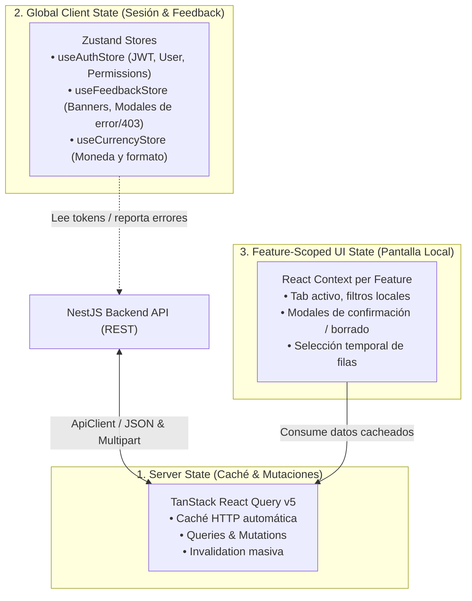

# Integración API y Gestión de Estado — Aranzed - Software de Gestión

Este documento detalla la arquitectura de comunicación con el backend, la capa del cliente HTTP (`ApiClient`), la estrategia de caché y sincronización remota con **TanStack React Query v5**, y la gestión de estado reactivo mediante **Zustand** y contextos de React.

---

## 🏛️ 1. Arquitectura de Estado: Separación de Responsabilidades

El frontend implementa una separación estricta del estado en tres niveles fundamentales para evitar la mezcla de datos de servidor con el estado efímero de la interfaz:



| Capa de Estado     | Herramienta                | Ejemplos de Contenido                                                 | Ciclo de Vida                                                |
| :----------------- | :------------------------- | :-------------------------------------------------------------------- | :----------------------------------------------------------- |
| **Server Cache**   | `@tanstack/react-query`    | Listas de productos, órdenes de compra, kardex, roles                 | Persiste en memoria según `staleTime` (2 min por defecto)    |
| **Global Client**  | `zustand`                  | Token JWT, perfil del usuario, banners de error global, moneda activa | Persiste en `localStorage` (`auth-storage`) o memoria global |
| **Screen / Local** | React Context & `useState` | Diálogo abierto (`isCreateOpen`), tab seleccionado, filtro de texto   | Se destruye al desmontar la vista o ruta                     |

---

## 🌐 2. Cliente HTTP Centralizado (`ApiClient`)

Ubicación del código: [`frontend/src/lib/api-client.ts`](file:///c:/Projects/NODE/ministore/frontend/src/lib/api-client.ts).

El `ApiClient` abstrae la API nativa `fetch`, gestionando de forma transparente autenticación, cabeceras, multipart y ciclo de vida de sesiones.

### 2.1 Inyección Automática de Autenticación

El cliente recupera automáticamente el token JWT serializado en el almacenamiento local por Zustand:

```typescript
public static getToken(): string | null {
  const storage = localStorage.getItem('auth-storage');
  if (storage) {
    try {
      const parsed = JSON.parse(storage);
      return parsed?.state?.token || null;
    } catch {
      return null;
    }
  }
  return null;
}
```

Si existe un token válido, añade automáticamente la cabecera:

```http
Authorization: Bearer <JWT_TOKEN>
```

### 2.2 Soporte para JSON y `multipart/form-data`

Si el cuerpo (`data`) es una instancia de `FormData` (por ejemplo, subida de logos, avatares o comprobantes), el cliente **no** fuerza la cabecera `Content-Type: application/json`, permitiendo que el navegador asigne el boundary `multipart/form-data; boundary=...` automáticamente.

### 2.3 Manejo Global de Códigos HTTP (401 y 403)

- **HTTP 401 (Unauthorized):** Indica que el token ha expirado o no es válido. `ApiClient` purga `localStorage.removeItem('auth-storage')` y fuerza la redirección inmediata a `/login`.
- **HTTP 403 (Forbidden):** Indica que el usuario autenticado no posee los permisos RBAC requeridos. `ApiClient` dispara `useFeedbackStore.getState().showForbidden(message)`, levantando un modal informativo sin cerrar la sesión del usuario.
- **Otros Errores (400, 404, 409, 500):** Se extrae el mensaje retornado por el backend NestJS (`responseData?.message`) y se propaga como una excepción de JavaScript.

### 2.4 Métodos Disponibles

```typescript
ApiClient.get<T>(endpoint, options?);
ApiClient.post<T>(endpoint, data, options?);
ApiClient.put<T>(endpoint, data, options?);
ApiClient.patch<T>(endpoint, data, options?);
ApiClient.delete<T>(endpoint, options?);
```

### 2.5 Helper de Recursos Estáticos (`getAssetUrl`)

Para resolver URLs de imágenes, logos o archivos adjuntos almacenados en el backend NestJS (carpeta `/uploads/`):

```typescript
import { getAssetUrl } from '@/lib/api-client';

// Entrada relativa: "/uploads/company/logo.png"
// Salida: "http://localhost:3000/uploads/company/logo.png" (o VITE_API_URL configurada)

```

---

## ⚡ 3. TanStack React Query v5

### 3.1 Configuración Global (`App.tsx`)

La aplicación inicializa el `QueryClient` con valores por defecto optimizados para sistemas ERP:

```typescript
const queryClient = new QueryClient({
  defaultOptions: {
    queries: {
      staleTime: 1000 * 60 * 2, // 2 minutos de vigencia de datos frescos
      refetchOnWindowFocus: false, // Evita peticiones innecesarias al cambiar de pestaña
      retry: 1, // Máximo 1 reintento automático en caso de falla de red
    },
  },
});
```

### 3.2 Convenciones de Nomenclatura para Query Keys

Las claves de consulta deben estructurarse jerárquicamente utilizando arreglos para facilitar invalidaciones parciales o completas:

```typescript
// Lista de compras con filtros
["purchases", { status: "PENDING", search: "PROV-1" }][
  // Detalle individual de compra
  ("purchases", purchaseId)
][
  // Módulo de inventario y submódulos
  ("inventory", "warehouses")
][("inventory", "stocks", warehouseId)][("inventory", "transactions")][
  // Catálogo
  ("catalog", "categories")
][("catalog", "products")];
```

### 3.3 Patrón de Mutaciones e Invalidación

Las mutaciones se encapsulan en hooks dedicados dentro de `hooks/mutations/` de cada feature. Al completarse con éxito, se invalidan las consultas vinculadas para garantizar consistencia inmediata:

```typescript
// Ejemplo: useTransactionMutations.ts
import { useMutation, useQueryClient } from "@tanstack/react-query";
import { ApiClient } from "@/lib/api-client";

export function useTransactionMutations() {
  const queryClient = useQueryClient();

  const createTransaction = useMutation({
    mutationFn: (data: CreateTransactionDto) =>
      ApiClient.post("/inventory/transactions", data),
    onSuccess: () => {
      // Invalida tanto el kardex como el stock consolidado
      queryClient.invalidateQueries({
        queryKey: ["inventory", "transactions"],
      });
      queryClient.invalidateQueries({ queryKey: ["inventory", "stocks"] });
    },
  });

  return { createTransaction };
}
```

---

## 🔔 4. Tienda Global de Feedback (`useFeedbackStore`)

Ubicación del código: [`frontend/src/shared/hooks/store/useFeedbackStore.ts`](file:///c:/Projects/NODE/ministore/frontend/src/shared/hooks/store/useFeedbackStore.ts).

Provee un sistema desacoplado para emitir alertas, errores de red y mensajes de éxito desde cualquier punto de la aplicación (incluyendo clases sin contexto de React como `ApiClient`).

### 4.1 Tipos de Feedback Soportados

- `'forbidden'`: Acceso denegado por políticas de seguridad o roles (HTTP 403).
- `'error'`: Fallas inesperadas, excepciones de servidor o validaciones rechazadas.
- `'warning'`: Advertencias operativas (ej. stock bajo o cotización por vencer).
- `'success'`: Notificación de transacciones completadas (soporta `autoCloseMs`).
- `'info'`: Mensajes informativos de proceso.

### 4.2 Métodos Principales

```typescript
const { showSuccess, showError, showForbidden, clearFeedback } =
  useFeedbackStore();

// Notificar guardado exitoso
showSuccess("El producto fue registrado con éxito", { autoCloseMs: 3000 });

// Notificar captura de error
showError(error, { title: "No se pudo guardar la orden" });

// Modal de restricción de permisos
showForbidden("No dispones de los permisos necesarios para anular esta venta");
```

---

## 🛡️ 5. Variables de Entorno y Configuración de Producción

El frontend hace uso de **Vite Environment Variables** prefijadas con `VITE_`.

| Variable       | Tipo   | Descripción                                       | Ejemplo Local           | Ejemplo Producción          |
| :------------- | :----- | :------------------------------------------------ | :---------------------- | :-------------------------- |
| `VITE_API_URL` | String | URL base absoluta donde escucha el backend NestJS | `http://localhost:3000` | `https://api.tuempresa.com` |

> [!IMPORTANT]
> Nunca incluyas credenciales secretas, claves privadas o tokens en variables `VITE_*`. Todas las variables prefijadas con `VITE_` son incrustadas en el bundle JavaScript estático generado en la compilación y son accesibles públicamente desde las herramientas de desarrollador del navegador.
