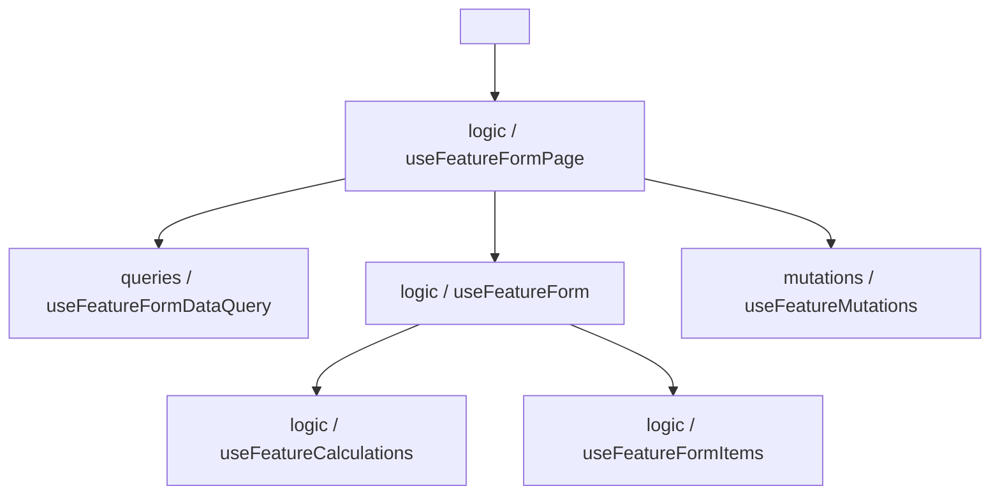

# Guía de Arquitectura Frontend — Ministore ERP

Este documento detalla los estándares de diseño arquitectónico, estructura de directorios y patrones de desarrollo aplicados en todo el frontend de **Ministore ERP**. Cada nueva pantalla, módulo o refactorización debe alinearse rigurosamente con estas convenciones.

---

## 1. Estructura de Directorios por Feature (`Feature-Sliced`)

Cada módulo bajo `src/features/<modulo>/` sigue una jerarquía estandarizada que separa la presentación, la lógica de negocio, las consultas a la API y el tipado:

```text
features/<feature_name>/
├── components/          # Subcomponentes agrupados por dominio
│   ├── header/          # Encabezados, títulos y barras de acción
│   ├── filters/         # Buscadores, dropdowns, selector de fechas
│   ├── table/           # Tablas, filas, badges de estado, paginador
│   ├── form/            # Secciones modulares de formularios
│   │   ├── header/      # Breadcrumbs y botones superiores
│   │   ├── sections/    # Cards temáticas (Datos básicos, Precios, Multimedia, etc.)
│   │   ├── actions/     # Barra flotante inferior (StickyBar)
│   │   ├── feedback/    # Banners de error y diálogos de éxito
│   │   └── states/      # Vistas de carga (Skeleton) y recuperación de error
│   ├── modal/           # Modales ligeros (confirmaciones o previsualizaciones)
│   ├── stats/           # Tarjetas de KPIs y métricas del módulo
│   └── index.ts         # Re-exportador de subcomponentes
├── context/             # Contextos de React dedicados al módulo
│   ├── <feature>ContextDefinition.ts       # Definición de tipos y createContext()
│   ├── use<Feature>Context.ts              # Hook consumidor exclusivo (Fast Refresh)
│   ├── <Feature>Context.tsx                # Componente Proveedor (FeatureProvider)
│   └── index.ts
├── hooks/               # Custom Hooks organizados por responsabilidad
│   ├── logic/           # Estado local, handlers y lógica de negocio
│   │   ├── use<Feature>Page.ts             # Orquestador de listado
│   │   ├── use<Feature>Form.ts             # React Hook Form + Zod + cálculos
│   │   ├── use<Feature>FormPage.ts         # Orquestador del formulario completo
│   │   ├── use<Feature>Calculations.ts     # Fórmulas financieras/matemáticas aisladas
│   │   └── use<Feature>FormItems.ts        # Renglones dinámicos (Header-Detail)
│   ├── queries/         # Peticiones de lectura (GET) con React Query
│   │   ├── use<Feature>Query.ts            # Consulta de listado
│   │   └── use<Feature>FormDataQuery.ts    # Carga paralela de catálogos y entidad
│   ├── mutations/       # Operaciones de escritura (POST, PUT, DELETE)
│   │   └── use<Feature>Mutations.ts
│   └── index.ts
├── pages/               # Vistas declarativas ultraligeras (< 80 líneas)
│   ├── <Feature>Page.tsx                   # Vista principal de listado
│   ├── <Feature>FormPage.tsx               # Vista de creación/edición
│   └── index.ts
├── schemas/             # Esquemas de validación Zod
│   └── <feature>.schema.ts
├── types/               # Interfaces y tipos de TypeScript
│   └── <feature>.ts
└── index.ts             # Punto de entrada público del módulo
```

---

## 2. Patrón de Separación en Tres Hooks (*Triple-Hook Pattern*)

Para formularios complejos (como Facturación de Ventas o Compras con múltiples monedas), se prohíbe el uso de "God Hooks" monolíticos. La lógica se descompone en tres capas limpias:



### 1. `queries/use<Feature>FormDataQuery.ts` (Capa de Carga)
- Ejecuta en paralelo la consulta de la entidad principal (si existe `:id`) y los catálogos auxiliares (almacenes, unidades de medida, categorías).
- Administra las banderas `loadingInitial`, `loadError` y la función `refetchInitial`.

### 2. `logic/use<Feature>Form.ts` (Capa de Formulario)
- Configura `useForm` con `@hookform/resolvers/zod` y sincroniza valores por defecto.
- Delega el cálculo de fórmulas a `use<Feature>Calculations.ts` y las filas dinámicas a `use<Feature>FormItems.ts`.

### 3. `logic/use<Feature>FormPage.ts` (Capa de Orquestación)
- Conecta la carga de datos, el formulario y las mutaciones de la API.
- Transforma los datos de la UI al payload esperado por el backend.
- Controla el estado de feedback (`isSuccessOpen`, `successMessage`) y las redirecciones de navegación.

---

## 3. Contexto de Feature y Cero Perforación de Propiedades (*Zero Prop Drilling*)

Para evitar pasar props a través de árboles profundos de subcomponentes:

1. **Definición Separada**: El archivo `context/<Feature>ContextDefinition.ts` exporta la interfaz y el `createContext<ContextType | null>(null)`.
2. **Hook Consumidor Dedicado**: El hook `use<Feature>Context.ts` reside en su propio archivo para cumplir con las reglas de Vite Fast Refresh y Oxlint (`react/only-export-components`). Incluye verificación de seguridad:
   ```typescript
   export function useFeatureContext(): FeatureContextType {
     const context = useContext(FeatureContext);
     if (!context) {
       throw new Error('useFeatureContext debe ser utilizado dentro de un FeatureProvider');
     }
     return context;
   }
   ```
3. **Consumo Directo en Subcomponentes**: Cada subcomponente (`FeatureFilterBar`, `FeatureTable`, etc.) extrae su estado directamente del contexto, permitiendo opcionalmente overrides vía props para testing unitario.

---

## 4. Vistas Declarativas Concisas

Los componentes de página (`pages/<Feature>Page.tsx`) no contienen lógica de estado en línea. Son piezas puramente ensambladoras y declarativas de menos de 80 líneas:

```tsx
import { FeatureProvider } from '../context';
import {
  FeaturePageHeader,
  FeatureStatsCards,
  FeatureFilterBar,
  FeatureErrorBanner,
  FeatureTable,
  FeatureDialogs,
} from '../components';

function FeaturePageContent() {
  return (
    <div className="space-y-6 max-w-8xl mx-auto pb-12 animate-in fade-in duration-300">
      <FeaturePageHeader />
      <FeatureStatsCards />
      <FeatureFilterBar />
      <FeatureErrorBanner />
      <FeatureTable />
      <FeatureDialogs />
    </div>
  );
}

export function FeaturePage() {
  return (
    <FeatureProvider>
      <FeaturePageContent />
    </FeatureProvider>
  );
}

export default FeaturePage;
```
