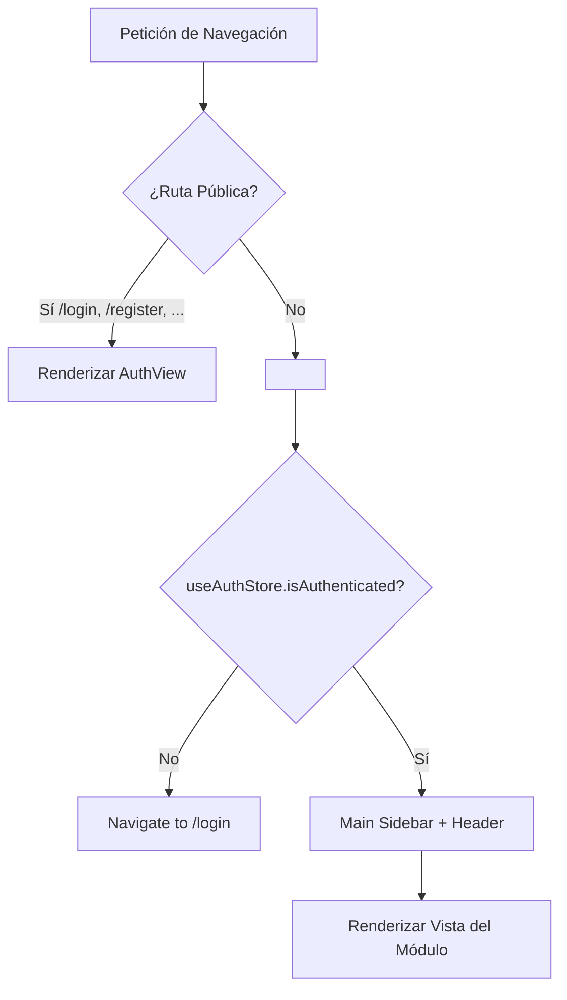

# Autenticación, Permisos y Enrutamiento — Ministore ERP

Este documento describe la arquitectura de seguridad, la gestión de sesiones de usuario y el sistema de enrutamiento modular del frontend.

---

## 🔐 1. Almacenamiento y Estado Global de Autenticación (`useAuthStore`)

La información de sesión se gestiona con **Zustand** y se persiste automáticamente en el navegador a través del middleware `persist`:

### Estructura del Estado (`useAuthStore.ts`)
```typescript
interface User {
  id: string;
  email: string;
  firstName?: string;
  lastName?: string;
  phone?: string;
  avatarUrl?: string | null;
  jobTitle?: string;
  roles?: string[];
  permissions?: string[];
}

interface AuthState {
  user: User | null;
  token: string | null;
  isAuthenticated: boolean;
  setAuth: (user: User, token: string) => void;
  updateUser: (user: Partial<User>) => void;
  logout: () => void;
}
```

- **Clave en Almacenamiento**: `localStorage.getItem('auth-storage')`.
- **Token Asimétrico**: El token JWT recibido está firmado con algoritmo **RS256** por el backend. El payload contiene los permisos agregados del usuario (`roles` + permisos directos).

---

## 🚦 2. Control de Acceso y Rutas Protegidas (`ProtectedRoute`)

El enrutador (`src/routes/index.tsx`) divide las pantallas en dos grupos:



### Componente `ProtectedRoute.tsx`
Verifica si el usuario está autenticado. Si no lo está, redirige a `/login` guardando la ruta actual para redirigir de regreso tras un login exitoso.

---

## 🛡️ 3. Validación Granular de Permisos en la Interfaz (RBAC)

Aunque el backend es la autoridad final que valida permisos mediante Guards, el frontend adapta dinámicamente la UI para evitar mostrar acciones denegadas:

```tsx
import { useAuthStore } from '@/shared/hooks/store/useAuthStore';

export function SalesActionToolbar() {
  const user = useAuthStore((state) => state.user);
  const canCreateSale = user?.permissions?.includes('sales:manage');

  return (
    <div className="flex items-center gap-3">
      {canCreateSale && (
        <Button variant="primary" onClick={handleNewSale}>
          Nueva Venta
        </Button>
      )}
    </div>
  );
}
```

---

## ⚡ 4. Manejo de Sesión Expirada (401) y Accesos Prohibidos (403)

El cliente HTTP (`ApiClient`) intercepta automáticamente las anomalías de autorización:

### Manejo de 401 Unauthorized (Token Expirado o Inválido)
1. El backend rechaza la firma RS256 o el tiempo de vida del token expiró.
2. `ApiClient` remueve inmediatamente la clave `auth-storage` del `localStorage`.
3. Ejecuta una redirección limpia a `/login`, impidiendo que la aplicación permanezca en un estado zombi con peticiones fallidas sucesivas.

### Manejo de 403 Forbidden (Acceso Denegado por RBAC)
1. El usuario está autenticado pero intenta realizar una acción sin el permiso requerido (ej: anular una venta sin `sales:manage`).
2. `ApiClient` llama a `useFeedbackStore.getState().showForbidden(errorMessage)`.
3. La interfaz despliega automáticamente un diálogo accesible explicando que el recurso está restringido, sin forzar la pérdida de los datos escritos en pantalla.

---

## 🗺️ 5. Modularización del Enrutador (`src/routes/`)

Las rutas no están agrupadas en un único archivo gigante. Se segregan por dominio de negocio:
- `auth.routes.tsx`: Login, Registro, Recuperación y Reseteo.
- `iam.routes.tsx`: Gestión de Usuarios, Roles y Permisos.
- `catalog.routes.tsx`: Productos, Recetas, Categorías y UOFM.
- `inventory.routes.tsx`: Almacenes, Stocks, Kárdex y Movimientos.
- `purchases.routes.tsx`: Listado y Formularios de Compras.
- `sales.routes.tsx`: Listado, Formularios de Ventas y Pagos.
- `company.routes.tsx`: Configuración institucional y moneda.
